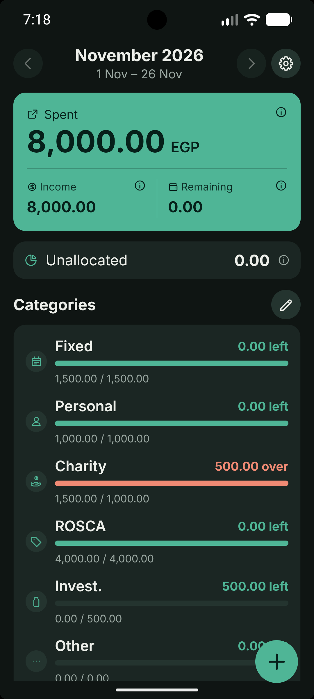
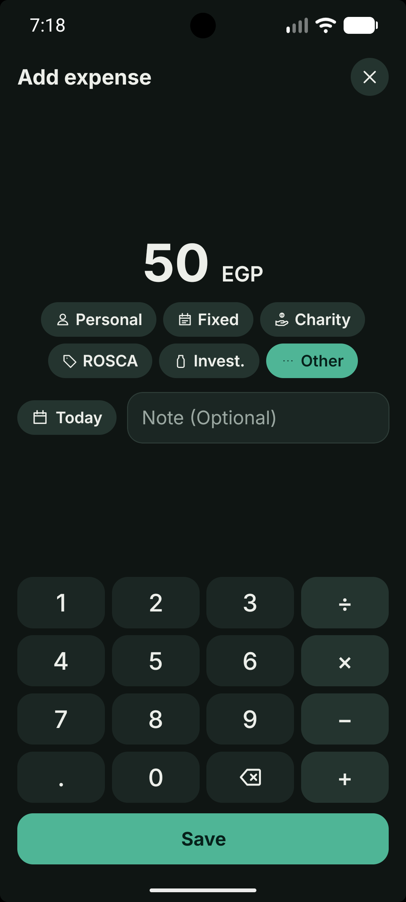
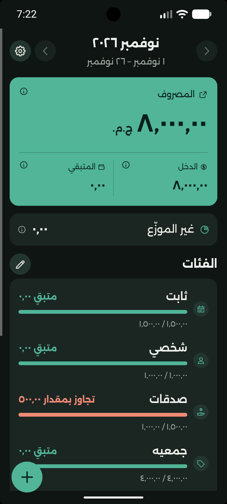
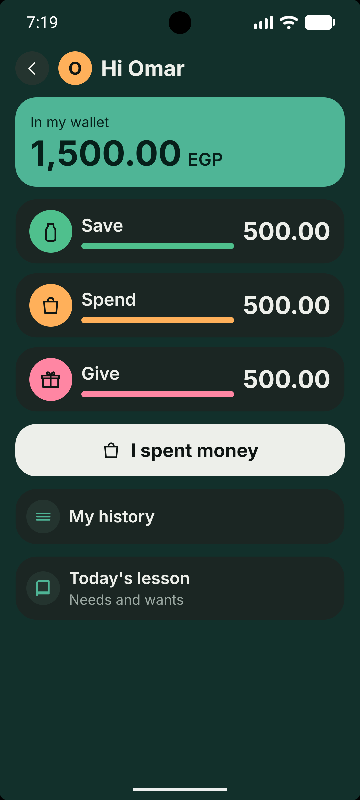
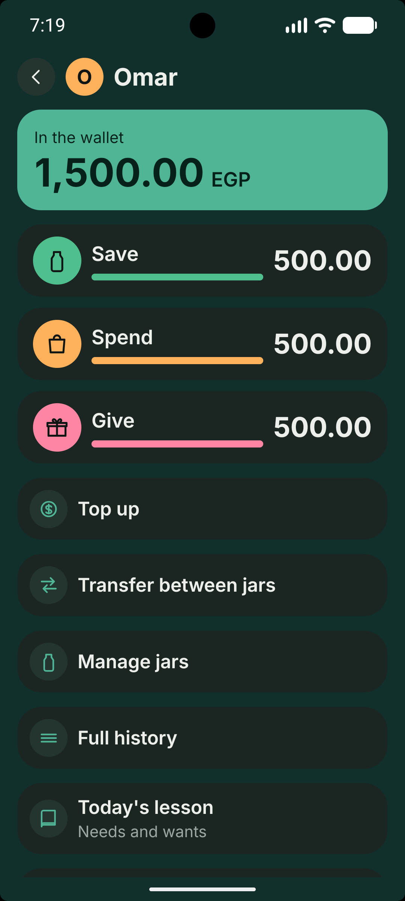
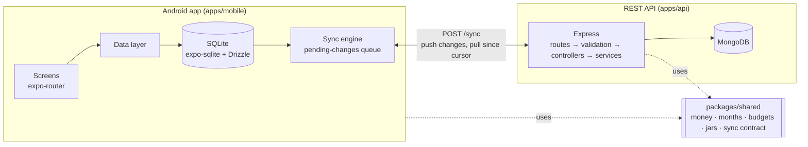

# Mizan — a simple, offline-first money tracker (English/Arabic)

[](https://github.com/ZiadMohamedAly14/simple-money-tracker/actions/workflows/ci.yml)
[](LICENSE)

Mizan (ميزان, "balance") is an Android app for planning a monthly budget and teaching kids about money. Adults split their expected income into category budgets and record spending in about three taps. Parents give each child a Kid Wallet with Save, Spend and Give jars, and the child's own phone can run a locked-down Kid Mode.

All money is virtual: there are no bank connections and no payments. The app works fully offline, syncs across devices when online, and supports English and Arabic with a full right-to-left layout.

## Screenshots

<table>
  <tr>
    <th>Month overview</th>
    <th>Record an expense</th>
    <th>Arabic, right to left</th>
  </tr>
  <tr>
    <td></td>
    <td></td>
    <td></td>
  </tr>
  <tr>
    <th>Kid Wallet (kid's phone)</th>
    <th>Kid Wallet (parent's view)</th>
    <th></th>
  </tr>
  <tr>
    <td></td>
    <td></td>
    <td></td>
  </tr>
</table>

## Features

- **Monthly budget.** Set an Expected Income, split it into Category Budgets and see what's Remaining. Months start on your own Pay Day, not just the 1st.
- **Fast recording.** Record income and expenses in about three taps. The keypad does simple math (`+ − × ÷`).
- **Kid Wallet.** Parents top up each child's wallet, split across jars (Save, Spend, Give), and can move money between jars. Kids record what they spend and read short lessons in the Learn section.
- **Kid Mode.** A child's phone holds a session limited to their own wallet. Leaving Kid Mode needs a Parent PIN or the parent's biometrics.
- **Offline-first sync.** Everything works without internet. Changes sync between devices when a connection returns.
- **Passwordless sign-in.** Sign in with a one-time code sent by email.
- **Bilingual.** English and Arabic, full RTL layout, and an option for Arabic-Indic digits. Light and dark themes.

## Tech stack

| Part | Stack |
|---|---|
| Mobile | Expo, React Native, TypeScript, expo-router, expo-sqlite with Drizzle, NativeWind (Tailwind), i18next |
| API | Node.js, TypeScript, Express 4, Mongoose, express-validator, JWT |
| Shared | One TypeScript package of domain logic, used by both the app and the API |
| Data | SQLite on the device, MongoDB on the server |
| Testing | Jest, mongodb-memory-server, more than 1,000 tests |
| CI and hosting | GitHub Actions, Railway (API), MongoDB Atlas, EAS Build (Android) |

## Architecture



The phone is the source of truth for what the user sees: every screen reads from and writes to the local SQLite database, so the app works the same offline. A sync engine pushes local changes and pulls changes from other devices through a single endpoint, using a server-version cursor. Conflicts are resolved per record by last write wins.

```
apps/mobile      Expo app (Android)
apps/api         REST API
packages/shared  domain logic, money/date helpers, sync contract
docs/adr         architecture decision records
.scratch         specs and tickets the app was built from
```

## Key decisions

Each decision is written up as a short [architecture decision record](docs/adr/):

| ADR | Decision | Why |
|---|---|---|
| [0001](docs/adr/0001-offline-sync-last-write-wins.md) | Per-record last-write-wins with tombstones | Data is mostly add-only, so CRDTs would be overkill; losing a rare concurrent edit is acceptable for virtual money |
| [0002](docs/adr/0002-scoped-kid-session.md) | Kid devices hold a narrowed Kid Session | A child's phone can never read or change the parent's budget |
| [0003](docs/adr/0003-local-store-expo-sqlite.md) | expo-sqlite with a hand-written sync layer | Real SQL for totals, and no dependency on a patchy sync framework |
| [0004](docs/adr/0004-money-as-integer-minor-units.md) | Money as integer minor units | No floating-point drift in budget totals |
| [0005](docs/adr/0005-backend-stack-with-deliberate-hardening.md) | A familiar Express stack, with hardened auth | Fast to build; rotating, hashed refresh tokens and rate limits |
| [0006](docs/adr/0006-client-generated-uuidv7-ids.md) | Client-generated UUIDv7 ids | Records can be created offline without asking the server for an id |
| [0007](docs/adr/0007-sync-protocol-server-version-cursor.md) | One sync endpoint with a server-version cursor | Devices never miss or repeat changes, even if a phone's clock is wrong |
| [0008](docs/adr/0008-hosting-on-a-small-budget.md) | Hosting for about $5 a month | An always-on API without paying for idle capacity |
| [0009](docs/adr/0009-pay-day-changes-keep-past-months.md) | Changing Pay Day never redraws past Months | Months you've already reviewed keep their numbers |

## How this was built

The project was built spec-first, with AI coding agents doing most of the implementation:

1. **Domain language first.** [GLOSSARY.md](GLOSSARY.md) defines every term (Month, Remaining, Jar, Top-up, Kid Session…), and the code uses exactly these names.
2. **Spec and scope.** [.scratch/mvp/spec.md](.scratch/mvp/spec.md) holds the user stories; [docs/mvp-scope.md](docs/mvp-scope.md) says what's in, what's out and what comes later.
3. **Decisions recorded as ADRs** as they were made, so trade-offs aren't lost.
4. **Tickets.** The spec is split into small vertical slices ([.scratch/mvp/issues/](.scratch/mvp/issues/), [.scratch/pay-day/](.scratch/pay-day/)), each with acceptance criteria.
5. **Agents implement, tests verify.** Each ticket was built test-first on its own branch and reviewed against the spec before merging. [CLAUDE.md](CLAUDE.md) and [docs/agents/](docs/agents/) hold the agent setup.

## Running it yourself

Requires Node 22 (see `.nvmrc`).

```sh
npm install            # installs every workspace
npm run typecheck      # tsc --noEmit in every workspace
npm test               # Jest in every workspace (API tests start an in-memory MongoDB)
npm run build          # builds packages/shared and apps/api to dist/
```

### API

1. Copy `apps/api/.env.example` to `apps/api/.env`. Every variable is described there and checked at start-up.
2. Start a MongoDB (local, Docker or Atlas) and set `MONGODB_URI`.
3. Run `npm run dev -w @money-tracker/api`.

Sign-in codes are sent by email. For local development, run a mail catcher and read the codes at http://localhost:8025:

```sh
docker run --rm -p 1025:1025 -p 8025:8025 axllent/mailpit
```

To send real email, set either the `SMTP_*` variables (for example Gmail with an App Password) or `RESEND_API_KEY`.

### Mobile

1. Copy `apps/mobile/.env.example` to `apps/mobile/.env` and point `EXPO_PUBLIC_API_URL` at your API. The Android emulator reaches your machine at `10.0.2.2`.
2. Run `npm start -w @money-tracker/mobile` and open a development build on an Android device or emulator.

### Deploying

- **API:** `railway.json` configures a Railway deploy: build command, start command and the `/health` check. Set `NODE_ENV=production`, `MONGODB_URI`, three different random secrets of 32+ characters (`JWT_ACCESS_SECRET`, `JWT_REFRESH_SECRET`, `CODE_HASH_SECRET`) and your email settings. Any Node host works the same way.
- **Android:** in `apps/mobile/app.json`, remove `owner`, `extra.eas.projectId` and `updates.url` (they belong to the original Expo project). Then, from `apps/mobile`, run `eas init`, replace the `REPLACE-WITH-…-API-URL` placeholders in `eas.json` with your API's URL, and run `eas build --platform android`.

## License

[MIT](LICENSE)
